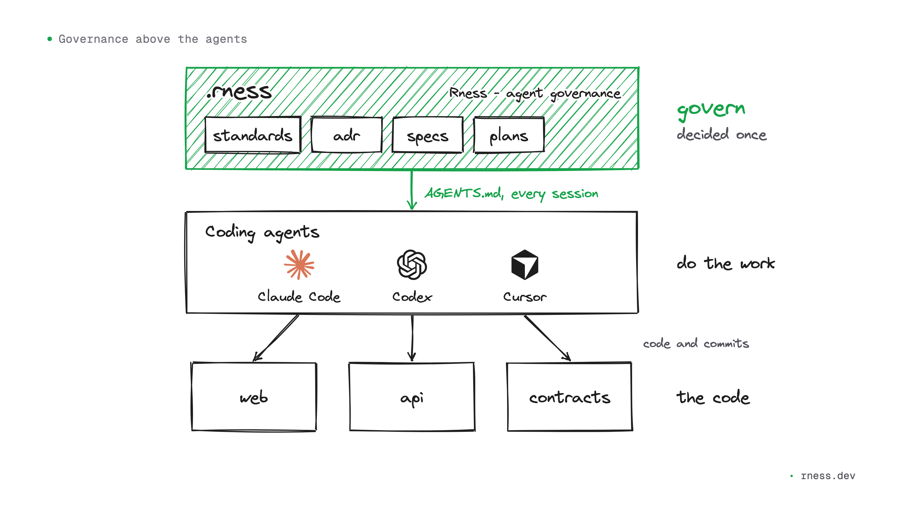
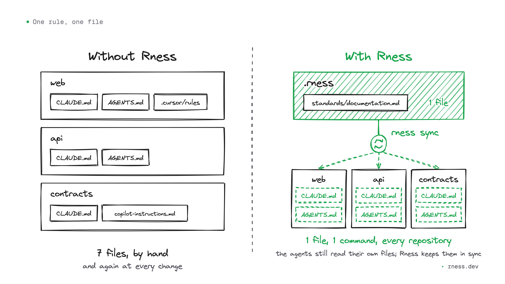

# Governing coding agents across repositories, with Markdown and git

I code with agents every day: Claude Code most of the time, Codex for a second opinion, Cursor or Devin in the editor. My GitHub organization holds several repositories, among them a command-line tool, its documentation and its website. An agent can know how a neighbouring repository works, provided the configuration of the repository it works in tells it. That is extra configuration in every repository, and keeping it in sync by hand soon gets heavy.

I wrote Rness to govern these agents from one place. It is an open-source tool, MIT licensed, that runs no model: it reads Markdown and writes Markdown, in your repositories. Here is how it works, what it already does for me, and where it is going.



## An agent only knows the file in front of it

Claude Code reads `CLAUDE.md`. Codex, Cursor and GitHub Copilot read `AGENTS.md`. Whatever is in that file, the agent knows at every session. Whatever is not does not exist for it.

In a team that codes with agents, one repository has a `CLAUDE.md`, an `AGENTS.md` and a `.cursor/rules` folder. The second has a `CLAUDE.md` copied from the first months ago, then edited. The third only has a `.github/copilot-instructions.md`. The architecture decision made last month sleeps in a document no agent opens. Each agent forms its own picture of the organization, and the more code agents write, the more those diverging pictures end up in the code.

## One rule, one file

Setting a rule for every agent of an organization starts as a count of files. Kept by hand, a rule goes into at least two files per repository, `CLAUDE.md` and `AGENTS.md`, and more as soon as `.cursor/rules` or Copilot's instructions get involved. Three repositories make six files at least; forty repositories, eighty. When the rule changes, you start again, and nothing flags the copy you forgot.



With Rness, the rule is written once, in a standard of the `.rness` repository. From it, the `rness sync` command rewrites a generated block in the `AGENTS.md` of every repository, and every `CLAUDE.md` already points to that block. Here is the top of the block in my website's repository:

```markdown
<!-- BEGIN rness -->
<!-- rness · scope: web · contract: 1 · hash: 69ac389a2b6b · generated: run `rness sync`, never edit inside this block -->
...
<!-- rness: standards/architecture.md -->
# Architecture and repository strategy
```

Each standard names the file it comes from, so you know where to change it. Each repository gets a small commit, and `rness sync --check` fails the CI of a repository whose block has fallen behind.

A recent example: I decided that no text I publish would carry an em dash, because that dash has become the signature of generated text. Three lines in a file of `.rness` and one command were enough for every repository of my workspace to have the rule, and for every new agent session to start with it.

## Everything stays in git

A workspace is one folder per person: the governance repository and a clone of each repository, side by side.

```text
<your-org>/
├── AGENTS.md          the root block, for a session started here (CLAUDE.md beside it)
├── .rness/            the governance repository
│   ├── standards/     the rules
│   ├── adr/           architecture decisions, and their reasons
│   ├── specs/         what to build
│   ├── plans/         how, task by task, each with its evidence
│   └── rness.json     the repositories, and which rules apply where
└── org/               one clone per repository
    ├── web/
    │   ├── AGENTS.md  the generated block, between its markers
    │   └── CLAUDE.md  points to AGENTS.md
    ├── api/
    └── contracts/
```

The `.rness` repository is a git repository like any other. Standards, architecture decisions (ADRs), specifications and plans are Markdown files in it, with a `rness.json` that says which rules apply to which repository. A rule changes through a commit, reviewed like code.

Rness does not sit between you and your agents. It writes into the files they already read, and in `AGENTS.md` it only touches its own block, between its two markers: the rest of the file is yours. It sends neither your code nor your context anywhere. The version of the tool is pinned in `.rness`, the same for the whole team; `rness upgrade` moves it and merges what it changes with git. For MCP clients, `rness mcp` serves the same context, read-only.

## One request, three repositories

The value shows when a change spills over one repository. I wanted to rename a command of the tool, `rness pulse`, to `rness board`: the old name meant three things at once, and `rness pulse sync` sat next to `rness sync` with nothing to tell them apart.

I asked for it once, as a specification in `.rness`, and the agent drew a plan from it. It works from the workspace, where the tool, the documentation and the website sit side by side under the same rules: it saw everything the rename touched. In under half an hour, it committed the new command and its tests in the tool, then the renamed pages of the documentation. It also updated the website's `llms.txt`, the file other AI agents read to learn how to use the tool. The new version was on npm about two hours after the specification.


## One decision, checked everywhere

The tool required Node 24. One day, a Claude Code session in one of my projects, which runs on Node 22, opened on a single line: `rness needs Node 24 or newer (running v22.22.0)`. The hook that loads the context had refused to start, Rness was off in that project, and that line was the only sign.

Moving down to Node 22.17 took a few lines of code, but the decision reached much further: the version check, the `engines` of three packages, the CI matrix, the README, the documentation, the website. I recorded it in an ADR, with a plan that gave each change its evidence. A few minutes after the decision was accepted, the tool, the documentation and the website each had their commit.

Before closing the plan, the `/rness:plan check` command, in Claude Code, replayed every piece of evidence. A wider search found two lines missed on the first pass, both on the website: the `llms.txt` still announced "Node 24 or later", and so did the structured data. They were fixed that same evening, and only then was the plan closed.

## What comes next

What Rness does today governs what agents know and what has been decided. The next layer will govern what they are allowed to do: policies with a scope, from the organization down to a folder or a file pattern, and a view of the whole organization that shows which repository has drifted from the rules. All of it is specified, none of it is built, and the site marks it "not shipped yet" until it ships.

Without an organization, `npm create rness my-project --blank` creates a workspace, and `rness add` adds a repository to it by its git URL. If you work on a free forge such as Forgejo or Gitea, tell me what gets in the way: that is what will help me choose what comes next.

Rness is at version 0.x: as long as it is, the commands and the `rness.json` contract may change from one minor version to the next, and every release says what changed.

## Try it, contribute

```bash
npm create rness
```

The command asks where your organization lives: GitHub, GitLab or Atlassian (Bitbucket for the code, Jira for the board). With `--blank`, it creates a workspace with no organization. Then `rness sync` writes the blocks and `rness status` shows where every decision, specification and plan stands. Rness is itself built with Rness: its rules, decisions and plans live in its own `.rness`.

The code is on [github.com/rness-dev/rness](https://github.com/rness-dev/rness), MIT licensed. Issues labelled `good first issue` are a good way in, and the [Discussions](https://github.com/rness-dev/rness/discussions) welcome ideas and questions. The full documentation starts at [Getting started](/guide/getting-started).

And you: what has your organization decided that your agents still do not know?
